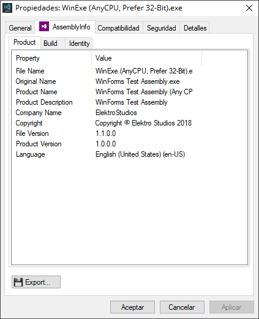
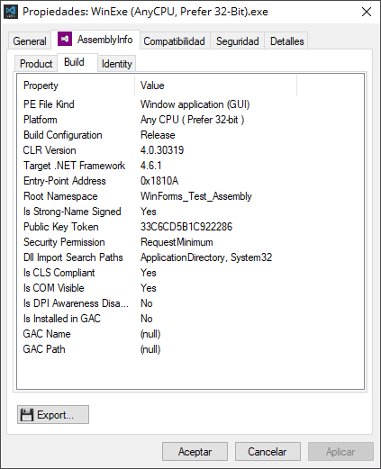
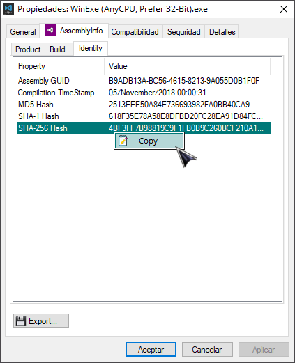

<!-- Common Project Tags:
desktop-app 
desktop-application 
dotnet 
dotnet-core 
netcore 
netframework 
netframework48 
tool 
tools 
vbnet 
visualstudio 
windows 
windows-app 
windows-application 
windows-applications 
windows-forms 
winforms 
 -->

------------------

 

  
  
  <h1>.NET Assembly Info Shell-Extension for Windows</h1>

### A shell-extension that shows info about .NET assemblies on its file properties dialog.

------------------

    &nbsp;
    &nbsp;
    &nbsp;
    
    &nbsp;
    
   
   
    
    
    
    
    
    
   
    
    
    
    
    
    
   
   
    

------------------

## 👋 Introduction

**.NET Assembly Info Shell-Extension for Windows** is a shell extension designed to seamlessly integrate into the Windows File Explorer. It enhances the standard Windows file properties dialog by adding a dedicated, data-rich "**AssemblyInfo**" tab whenever a `.dll` or `.exe` .NET assembly is inspected, built for any of these platforms:

 - **.NET Framework** (1.x to 4.8.1).
 - **.NET Core** (1.x to 3.1) and **.NET 5 or newer**, including **single-file** executables (`PublishSingleFile`, compressed or not).
 - **.NET Standard** libraries (and legacy portable class libraries).

Native AOT executables are not supported, as they do not contain .NET metadata. 

This extension extracts deep metadata, build architectures, security attributes, and identity signatures directly from the assembly's manifest, rendering a comprehensive diagnostic report right inside the OS user interface without requiring heavy external decompilers or development environments.

## 💡 Motivation

For developers, reverse engineers, and system administrators, inspecting .NET assemblies on the fly has historically required launching standalone utilities such as ILSpy, dnSpy, or the traditional `ildasm`. While powerful, these tools introduce unnecessary friction into everyday asset management, quick deployments, and troubleshooting pipelines. 

Windows native property sheets inherently fail to distinguish between standard Win32 PE files and managed .NET binaries, hiding critical framework-specific telemetry. This tool was created to bridge that gap permanently—bringing binary inspection directly to the context menu, saving time, and streamlining deployment auditing with a clean, exportable interface.

##### ⚡ The Real Question
###### Why waste time opening specialized standalone decompilers or complex IDEs just to verify a target framework, platform architecture, public key token, or compilation timestamp, when you can gather all that critical metadata instantly with a single native right-click?

## ✨ Features

The information is organized in six tabs:

| Tab | Information |
| :--- | :--- |
| **Product** | Version resource: file name, product, description, comments, company, copyright, trademarks, product and file versions. |
| **Build** | Output type, platform (Any CPU, x86, x64, ARM64...), target framework and OS platform, build configuration, optimizations, deterministic build, compilation timestamp, debug symbols (PDB), entry point, mixed-mode (C++/CLI), ReadyToRun, reference assembly and root namespace. |
| **Identity** | Assembly name, version, culture, full name, strong-name signature, public key token, assembly GUID, module version ID (MVID), Global Assembly Cache (GAC) installation, and MD5, SHA-1 and SHA-256 hashes. |
| **Attributes** | Neutral resources language, CLS compliance, COM visibility, DPI awareness, DLL import search paths, security permissions, key file/container, delay sign, `InternalsVisibleTo` friend assemblies, COM classes and `AssemblyMetadata` pairs (e.g. RepositoryUrl, RepositoryCommit). |
| **References** | Referenced assemblies (with version) and native DLLs imported through P/Invoke. |
| **Runtime** | Single-file bundle details, deployment model (framework-dependent or self-contained), trimming, `runtimeconfig.json` and `app.config` settings (frameworks, roll forward, configuration properties, supported runtimes, binding redirects), and the Win32 manifest settings (UAC execution level, DPI awareness, supported OS, Common Controls v6, long path awareness, active code page). |

And it provides these tools:

 - **Filter box** to show only the rows whose name or value contains a text.
 - **Export** all the tabs, the current tab or the selected rows to a **text, Markdown, HTML, JSON, XML or CSV** file.
 - **Copy all** the tabs to the clipboard, as plain text or Markdown (handy for GitHub issues); or copy single rows and values from the context menu.
 - **Compare** the assembly with another one, row by row: equal rows in green, different rows in red.
 - **View the Win32 manifest** and the **configuration files** (`app.config`, `runtimeconfig.json`, `deps.json`), sidecar or embedded in a single-file bundle.
 - **Open in Registry Editor** the COM registration (type library and classes) of the assembly, when it is registered.
 - **Show in the GAC folder** the assembly file, when it is installed in the Global Assembly Cache.

The assemblies are read exclusively through their PE headers and metadata: they are never loaded into the Explorer process.

## 🖼️ Screenshots

 

## 📝 Requirements

- Microsoft Windows OS.

## 🚀 Getting Started

1. Navigate to the **[Releases page](https://github.com/ElektroStudios/.NET-Assembly-Info-Shell-Extension-for-Windows/releases/latest)**.
2. Download the latest `.zip` archive or the `.exe` setup installer, depending on your preference.
3. If you downloaded the `.zip` archive, extract its contents to your preferred directory.
     
   If you downloaded the `.exe` file, run it and follow the installation wizard.

After you have installed the shell-extension, do right click on a .dll or .exe file (that is built with .NET Framework, .NET Core / .NET 5+ or .NET Standard) to show the file menu, click on the "Properties" option, and finally you will see a tab with name "AssemblyInfo" (see the 'Screenshots' section of this README).

From the tab with name "AssemblyInfo", you can see the information that this shell-extension can provide; also, you can use the "Export" button to generate a report like in this example (text format):

    C:\Program Files\ElektroStudios\.NET Assembly Info Shell-Extension\AssemblyInfo.dll
     
    Product
    -------
    File Name         : AssemblyInfo.dll
    Original File Name: AssemblyInfo.dll
    Product Name      : .NET Assembly Info Shell-Extension
    File Description  : .NET Assembly Info Shell-Extension
    Comments          : A shell-extension that shows info about .NET assemblies on the file properties
    Company           : ElektroStudios
    Copyright         : Copyright © ElektroStudios 2018-2026
    Trademarks        : (none)
    Product Version   : 1.2.0.0
    File Version      : 1.2.0.0
     
    Build
    -----
    Output Type             : Class Library (DLL)
    Platform                : Any CPU
    Target Framework        : .NET Framework 4.8.1
    Target OS Platform      : (none)
    CLR Version             : 4.0.30319
    Build Configuration     : Release
    Code Optimizations      : Enabled
    Deterministic Build     : No
    Compilation Timestamp   : 09/November/2026 06:54:14 UTC+01:00
    Debug Symbols (PDB)     : C:\Projects\NET Assembly Info ShellEx\obj\Release\AssemblyInfo.pdb (Windows PDB)
    Entry Point             : (none)
    Mixed-Mode (Native Code): No
    ReadyToRun (Precompiled): No
    Reference Assembly      : No
    Root Namespace          : (none)
     
    Identity
    --------
    Assembly Name           : AssemblyInfo
    Assembly Version        : 1.2.0.0
    Culture                 : neutral
    Full Name               : AssemblyInfo, Version=1.2.0.0, Culture=neutral, PublicKeyToken=null
    Strong-Name Signature   : Not signed
    Public Key Token        : (none)
    Assembly GUID           : 68951AE5-7484-4EC1-120D-7DD1D4AA8832
    Module Version ID (MVID): 670E96DF-D9BD-43EF-9E0F-5332F7350B44
    Installed in GAC        : No
    GAC Name                : (none)
    GAC Path                : (none)
    MD5 Hash                : B6185A0D87F287C530AB3524D8ECCE43
    SHA-1 Hash              : E85E426C4FCF4EB479E99A3B8487C2DD375322DD
    SHA-256 Hash            : 7A46E1124C251E3677B729E7C58FB04D20FE7B77AB0C851CE83757D7BC514C90
     
    Attributes
    ----------
    Neutral Resources Language: English (United States) (en-US)
    CLS Compliant             : (not specified)
    COM Visible               : No
    DPI Awareness Disabled    : No
    DLL Import Search Paths   : (default)
    Security Permissions      : (none)
    Key File                  : (none)
    Key Container             : (none)
    Delay Sign                : (not specified)
    Internals Visible To      : AssemblyInfo.Tests
     
    References
    ----------
    Microsoft.VisualBasic       : 10.0.0.0
    mscorlib                    : 4.0.0.0
    SharpShell                  : 2.7.2.0
    System                      : 4.0.0.0
    System.Collections.Immutable: 10.0.0.9
    System.Core                 : 4.0.0.0
    System.Drawing              : 4.0.0.0
    System.Reflection.Metadata  : 10.0.0.9
    System.Runtime.Serialization: 4.0.0.0
    System.Windows.Forms        : 4.0.0.0
    System.Xml                  : 4.0.0.0
    System.Xml.Linq             : 4.0.0.0
    Fusion.dll                  : Native library (P/Invoke)
    user32.dll                  : Native library (P/Invoke)
     
    Runtime
    -------
    Single-File Bundle                                      : No
    Deployment                                              : Framework-dependent (.NET Framework)
    Trimmable                                               : (not specified)
    Runtime Config                                          : (none)
    App Config                                              : AssemblyInfo.dll.config (sidecar file)
    Supported Runtimes                                      : v4.0 (.NETFramework,Version=v4.8.1)
    Binding Redirect: System.Runtime.CompilerServices.Unsafe: 0.0.0.0-6.0.3.0 -> 6.0.3.0
    Win32 Manifest                                          : (none)

## 🔄 Change Log

Explore the complete list of changes, bug fixes, and improvements across different releases by clicking [here](/Docs/CHANGELOG.md).

## 💪 Contributing

Your contribution is highly appreciated!. If you have any ideas, suggestions, or encounter issues, feel free to open an issue by clicking [here](https://github.com/ElektroStudios/.NET-Assembly-Info-Shell-Extension-for-Windows/issues/new/choose). 

Your input helps make this Work better for everyone. Thank you for your support! 🚀

## 💰 Beyond Contribution

This work is distributed for educational purposes and without any profit motive. However, if you find value in my efforts and wish to support and motivate my ongoing work, you may consider contributing financially through the following options:

| Platform | How to Support |
| :---: | :--- |
|  | **[Become my sponsor on GitHub](https://github.com/sponsors/ElektroStudios/)** Contribute any amount you prefer and unlock rewards! |
|  | **[Support me on Ko-fi](https://ko-fi.com/elektrostudios)** Buy me a coffee! |
|  | **[Become a Patron on Patreon](https://www.patreon.com/c/elektrostudios/membership)** Support my open-source work regularly! |
|  | **[Make a PayPal Donation](https://www.paypal.com/cgi-bin/webscr?cmd=_s-xclick&hosted_button_id=E4RQEV6YF5NZY)** Donate any amount you like via PayPal! |
|  | **[Purchase my software at Envato's CodeCanyon](https://codecanyon.net/item/elektrokit-class-library-for-net/19260282)** Discover my desktop tools and **DevCase Class Library for .NET**, an extensive API suite. |

 

  <b>Your support means the world to me! Thank you for considering it! 🤗💗</b>

------------------

## 🏆 Credits

This work relies on the following technologies, libraries or resources: 

 - [.NET Framework](https://dotnet.microsoft.com/en-us/download/dotnet-framework)
 - [SharpShell](https://github.com/dwmkerr/sharpshell)
 - [System.Reflection.Metadata](https://www.nuget.org/packages/System.Reflection.Metadata)

## ⚠️ Disclaimer

This software and its associated repository are provided strictly on an "as is" basis, without warranties of any kind, whether express or implied. This includes, but is not limited to, any implied warranties of merchantability, reliability, or fitness for a particular purpose.

The authors and copyright holders assume no liability for any direct, indirect, incidental, or consequential damages—including data loss or system errors—arising from the use, misuse, or inability to use this software. You are solely responsible for determining the appropriateness of using this tool and assume all associated risks.

Furthermore, this project operates entirely independently. The utilization of any third-party libraries or components within this software does not imply any affiliation with, or endorsement or approval by, their respective original authors.

This project is licensed under the **Apache License, Version 2.0**. See the  [License](./LICENSE) file for details.
